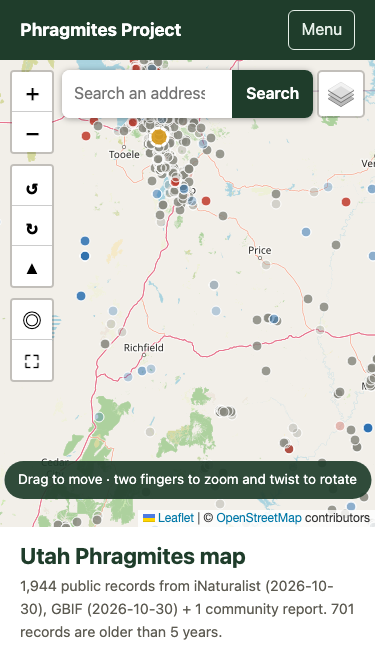
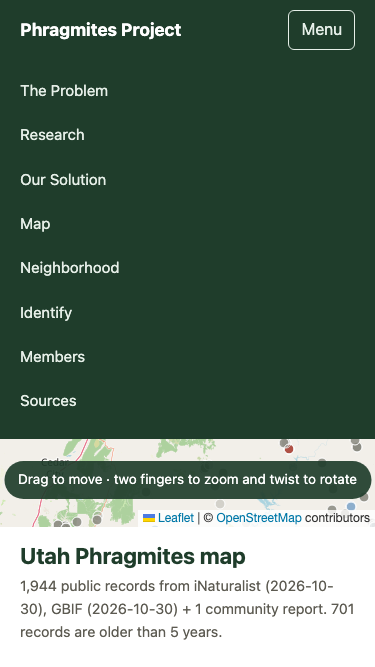
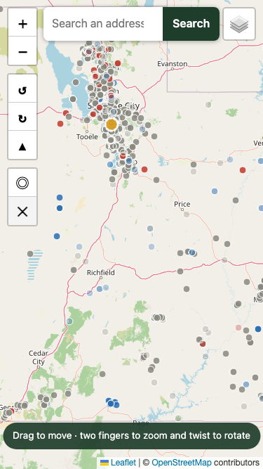

# Testing evidence: mobile menu hidden behind the map

| | |
|---|---|
| **Bug** | On phones, the Menu dropdown on the Map page opens behind the map |
| **Fix commit** | `bf77c1d` "Fix mobile menu hidden behind the map" |
| **Files changed** | `map.css` (`.map-wrap { z-index: 0 }`), `community.css` (`.pick-map { isolation: isolate }`) |
| **Tested on** | 2026-11-19, local static server (`python3 -m http.server`), `main` working tree with the fix |
| **Tool** | Playwright, headless Chromium, 375x667 viewport, `isMobile` and touch enabled |
| **Script** | [tests/mobile-menu.check.js](../../tests/mobile-menu.check.js) (original run used the same logic with local paths) |

## 1. The bug, as a visitor sees it

On a phone, a visitor opens the Map page and taps **Menu**. The links open, but the map is drawn over them. The visitor can't tap any link without scrolling the page to find the menu.

**Cause:** the header (and its dropdown) has `z-index: 10`. The map container had no z-index of its own, so Leaflet's internal layers (z-index 400 to 1000) and the search box and hint (1100) competed with the header at the page level and won.

## 2. Before and after

| Before (fix switched off in the test) | After (fix applied) |
|---|---|
|  |  |
| Only the header shows. The links are behind the map. | All 8 links show under the header and can be tapped. |

"Before" was simulated by injecting `.map-wrap:not(.full){z-index:auto !important}` into the page, which restores the old behaviour. The original code was not checked out for this run.

## 3. Test cases and results

| # | Step | Expected | Result |
|---|---|---|---|
| 1 | Open `map.html` at 375x667, tap Menu | All 8 links visible over the map | **Pass** (8/8 on top) |
| 2 | Same, with the fix switched off | Menu hidden behind the map (confirms the test can detect the bug) | **Pass**: screenshot shows menu hidden; the automated count showed 6/8 on top, which understates it, so the screenshot is the evidence here |
| 3 | Menu closed: zoom control, address search box, layers button | Still on top of the map | **Pass** |
| 4 | Tap the fullscreen button | Map fills the whole screen | **Pass**: map rect was `[0, 0, 375, 667]` and covered the top-left of the page |
| 5 | Open `community.html` | Page loads | **Pass** (title "Neighborhood Photos") |



## 4. Raw output

Menu and fullscreen run:

```
WITH FIX (map.html): 8/8 menu links on top
WITHOUT FIX (simulated): 6/8 menu links on top | covered: The Problem, Our Solution
Map controls: zoom control covered
Fullscreen: {"full":true,"topLeftInMap":true,"rect":[0,0,375,667]}
community.html loaded, title: Neighborhood Photos
```

"Map controls: zoom control covered" in this run was a false alarm: the menu was still open from the previous step and was correctly sitting over the zoom control. Re-run with the menu closed:

```
{"zoom":"on top","search":"on top","layers":"on top"}
```

## 5. Not tested

- Desktop layout (above 760px wide). The change is only a z-index on the map container, but it was not checked.
- `community.html` location mini-map with the Menu open. Only that the page loads was checked.
- Real phones or Safari. Only emulated Chromium was used.
- The "before" state used a simulated override rather than the original commit.
