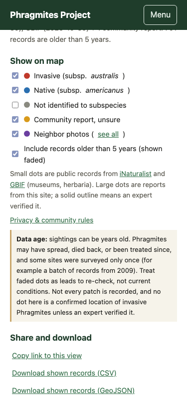
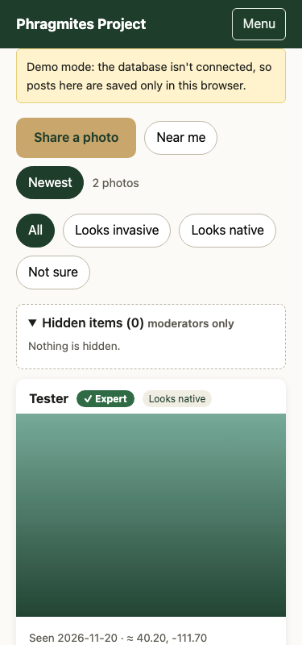

# Testing evidence: first batch of small features and bug fixes

| | |
|---|---|
| **Branch** | `small-features-qol` |
| **Tested on** | 2026-11-19, local static server, headless Chromium (Playwright 1.59.1), 375x800 viewport |
| **Script** | [tests/small-features.check.js](../../tests/small-features.check.js) |
| **Result** | 18 of 18 checks passed |

## How it was tested

The script runs the site in **demo mode**: it serves an empty `config.js`, so every save goes to the browser's `localStorage` and the live Supabase project is never touched. The sign-in check serves a fake Supabase address and answers the sign-in request itself. Because of this, the **real database rules were not tested** (see "Not tested").

## What changed and the result

| Change | Check | Result |
|---|---|---|
| **Bug:** Neighborhood page jumped back to the linked post on every redraw | Open `community.html#post-...`, scroll to the top, press Newest | **Pass**: stays at 0 px. The old `community.js` from `main` jumped to 1567 px in the same test, so the bug was reproduced and fixed |
| **Bug:** Verify/Reject gave no feedback and could be double-clicked | Force the save to fail, press Verify | **Pass**: an error message appears and the buttons turn back on |
| **Bug:** a new expert's own report didn't appear in their review queue until reload | File a report as an expert | **Pass**: appears in the queue straight away (found while writing the test) |
| **Bug:** record files reloaded after every report | Count requests for `data/inat-utah.json` after filing a report | **Pass**: 0 extra requests |
| **Bug:** sign-in button could send many emails | Press the button twice; advance the clock 61 s | **Pass**: one request, button off, then back on after 60 s |
| **Bug:** README said to re-run the data scripts every few weeks | Read | Fixed in `README.md` (not an automated check) |
| Remembered map filters | Untick a box, reload | **Pass** |
| Copy link to this view | Move the map, copy, open the link in a new page | **Pass**: same centre and zoom |
| Download shown records (CSV, GeoJSON) | Download with one category unticked | **Pass**: row count equals the records shown (321), the unticked category is absent, every row has a credit, GeoJSON has `credits` and `[lng, lat]` points |
| Neighborhood filter chips | Two posts (invasive, native); press each chip | **Pass**: filters correctly; an empty result says "No photos match this filter" |
| Posting rules on the photo and report forms | Read the form | **Pass** (photo form checked by the script; the report-form line was added in `map.html` and is not asserted) |
| Moderator "Hidden items" panel | Hide a post, reload, restore it; then view as a visitor | **Pass**: listed, restored into the feed, hidden from non-moderators |

## Screenshots

Map panel on a phone: remembered filters (one box unticked) and the new Share and download buttons.

Neighborhood page on a phone: filter chips and the moderator Hidden items panel.

## Not tested

- **Real database permissions.** Restore sets `status = 'visible'` and `hidden_by = null`. I checked this against the column grants and policies in `supabase/community.sql`, but never ran it against the live Supabase project. Try it once with a real expert account.
- **Expert Verify/Reject against Supabase** (only the failure message was tested, with a forced error).
- **The sign-in email itself.** The request was answered by the test, so no email was sent.
- Desktop layout of the new buttons and chips; only 375 px was used.
- Real phones or Safari; only emulated Chromium was used.
- The report-form rules sentence in `map.html` is not asserted by a check.
