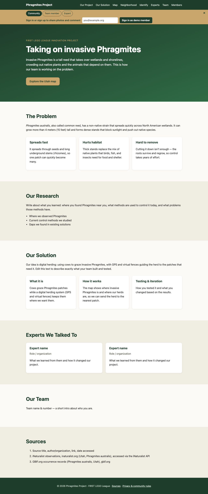
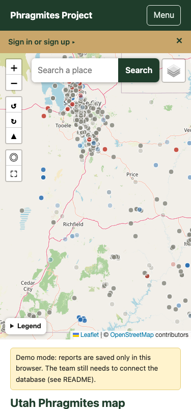

# Visual polish (2026-11-22)

Follows a screenshot review of every page at 1280 px and 375 px (demo mode).

| Problem | Change | Checked |
|---|---|---|
| Menu differed on every page (5 to 10 links) | One 8-link menu everywhere; Sources moved to the footer | All 6 pages |
| Logo not lined up with the page text | Header uses the page width; logo and text both start 20 px in at 941 and 1000 px | Measured |
| Sign-in bar too loud and tall | Slimmer, lined up with the page; on phones it starts as one line (44 px, was about 200) and opens on tap | Opens and focuses the email box |
| Map panel long | "Report a sighting" moved to the top; "Share and download" and the data-age note fold away | Screenshot |
| Map search hint cut off on phones | Shorter hint "Search a place" | Screenshot |
| Neighborhood rules box always open | Folds to one line | Screenshot |
| No site icon, no top headings | `favicon.svg`; each page's title is now an `<h1>` | Icon loads (200) |

The Menu button now takes over below 940 px (was 1180 px), since the shorter menu fits.

Tests: bug-fixes 6/6, risk-fixes 7/7, small-features 18/18 (now opens the "Share and download" fold first), cows 14/14, mobile menu 8/8.

