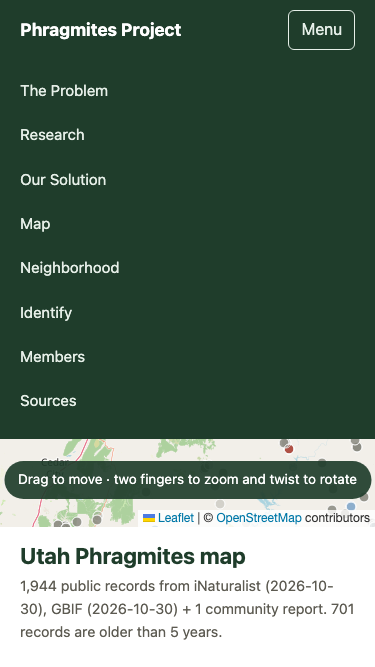

# Fix mobile menu hidden behind the map

## Summary
On phones, tapping **Menu** on the Map page opened the links, but the map was drawn over them, so visitors had to scroll down to reach them. The menu now opens on top of the map and its links can be tapped straight away.

## The issue, functionally
A visitor on a phone opens the Map page and taps **Menu**. The map covers the links, so they can't tap Problem, Research, Neighborhood or any other link without scrolling the page to find the menu.

## The fix, functionally
Tapping **Menu** on the Map page shows the links on top of the map, right under the header, with no scrolling. The map behaves as before: pan, zoom, search, locate, compass and fullscreen all work, and fullscreen still covers the whole screen.

## Technical cause and change
The header (and its dropdown) has `z-index: 10`. The map container had no z-index of its own, so Leaflet's internal layers (400 to 1000) and the search box and hint (1100) competed with the header at page level and won.

- `map.css`: `.map-wrap` gets `z-index: 0`, which keeps the map's layers inside the map. `.map-wrap.full` (z-index 3000) is unchanged.
- `community.css`: `.pick-map` (the Neighborhood location mini-map) gets `isolation: isolate`, the same containment.

## Also in this change
- `AGENTS.md`: contributor guide (structure, commands, conventions).
- `tests/mobile-menu.check.js`: Playwright phone-width check.
- `docs/testing.md` (index), `docs/evidence/mobile-menu-fix.md` (evidence), `docs/testing/` (screenshots).

## Testing
Run with Playwright (headless Chromium, 375x667, touch emulation). Full evidence: `docs/evidence/mobile-menu-fix.md`.

| Check | Result |
|---|---|
| Map page, tap Menu: all 8 links on top of the map | Pass |
| Same with the fix switched off (simulated) | Bug reproduced: menu hidden behind the map |
| Zoom control, search box, layers button on top (menu closed) | Pass |
| Fullscreen fills the 375x667 screen | Pass |
| `community.html` loads | Pass |

## Not tested
- Desktop layout (above 760px wide).
- The Neighborhood location mini-map with the Menu open (only that the page loads).
- Real phones or Safari; only emulated Chromium.
- The "before" state was simulated, not the original code.
