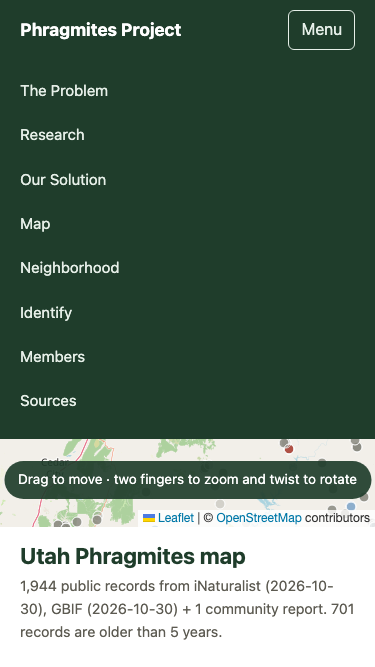
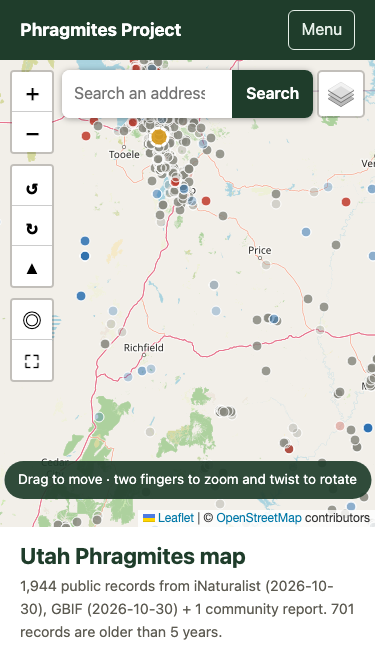
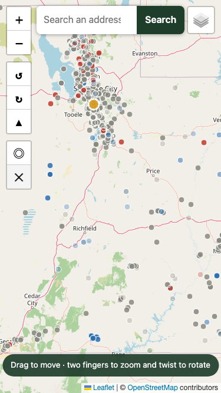

# Testing notes

The site has no automated test suite. This file records the checks that were run and how to repeat them.

## Mobile menu hidden behind the map (fixed in commit bf77c1d)

**Issue:** On a phone, tapping **Menu** on `map.html` opened the links, but the map covered them, so visitors had to scroll to reach them.

**Fix:** `.map-wrap` in `map.css` got `z-index: 0` (and `.pick-map` in `community.css` got `isolation: isolate`), so the map's internal layers can no longer paint over the header menu.

### What was tested (Playwright, Chromium, 375x667, touch emulation)

| Check | Result |
|---|---|
| `map.html`, tap Menu, all 8 links visible on top of the map | Pass |
| Same page with the fix switched off (simulated) | Bug reproduced as expected: menu hidden behind the map |
| Zoom control, address search box and layers button on top of the map (menu closed) | Pass |
| Fullscreen button makes the map fill the whole screen (375x667) | Pass |
| `community.html` loads | Pass |

Not tested: desktop layout, and the `community.html` location mini-map with the menu open.

### Screenshots

With the fix: the menu opens over the map.



Without the fix (simulated): the menu is hidden behind the map.



Fullscreen map (with the fix): the map fills the whole screen.



### Repeat it

Install Playwright once in a folder outside the project, so `node_modules` doesn't end up in the repo:

```
mkdir ~/playwright-tools && cd ~/playwright-tools
npm install playwright && npx playwright install chromium
```

Then, from the project root, in two terminals:

```
python3 -m http.server 8000
NODE_PATH=~/playwright-tools/node_modules TARGET_URL=http://localhost:8000 OUT_DIR=/tmp node tests/mobile-menu.check.js
```

The script is [tests/mobile-menu.check.js](../tests/mobile-menu.check.js). It prints the results below and saves screenshots to `OUT_DIR`:

```
WITH FIX (map.html): 8/8 menu links on top
WITHOUT FIX (simulated): 6/8 menu links on top | covered: The Problem, Our Solution
Map controls: zoom control covered
Fullscreen: {"full":true,"topLeftInMap":true,"rect":[0,0,375,667]}
community.html loaded, title: Neighborhood Photos
```

Two lines in that output look wrong but aren't:
- The no-fix count (6 of 8) understates the bug. The screenshot shows the whole menu hidden, so judge that case by the screenshot.
- "zoom control covered" happens because the menu is still open at that step and correctly sits over the zoom control. With the menu closed, the zoom control, search box and layers button are all on top.

Full evidence for this fix, with raw output and limits: [evidence/mobile-menu-fix.md](evidence/mobile-menu-fix.md).
